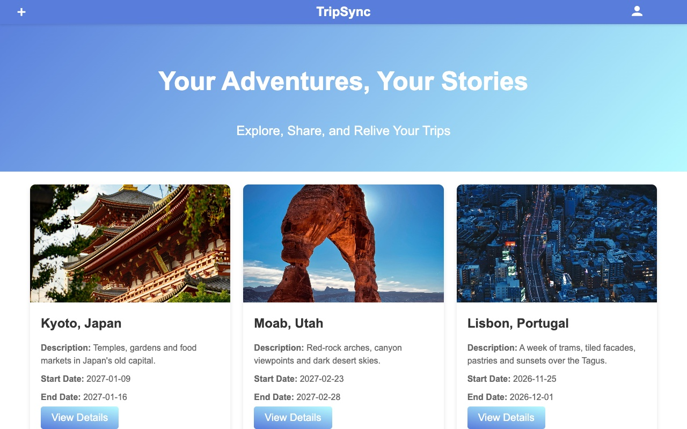
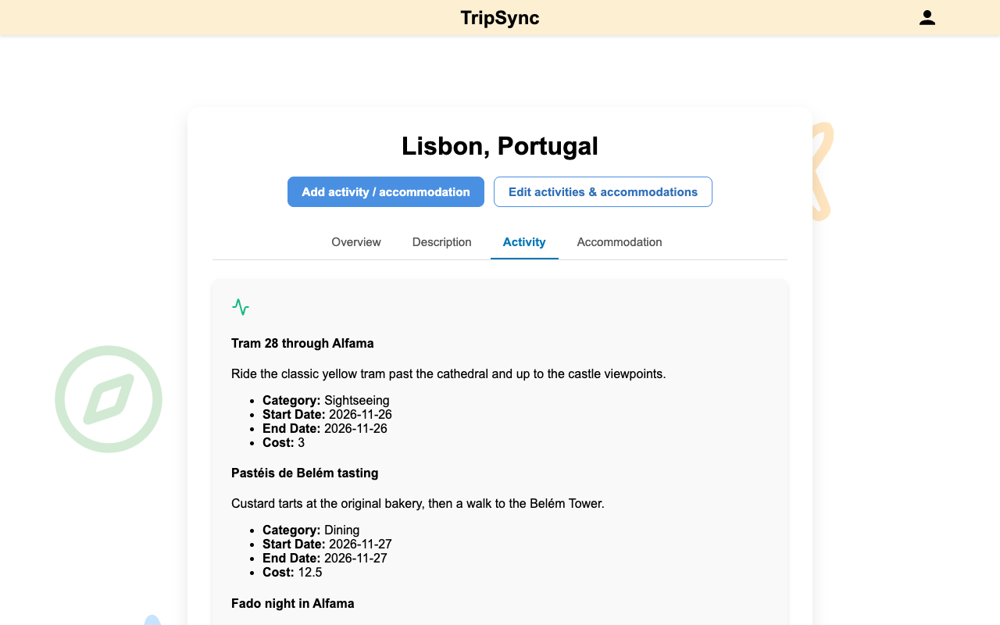
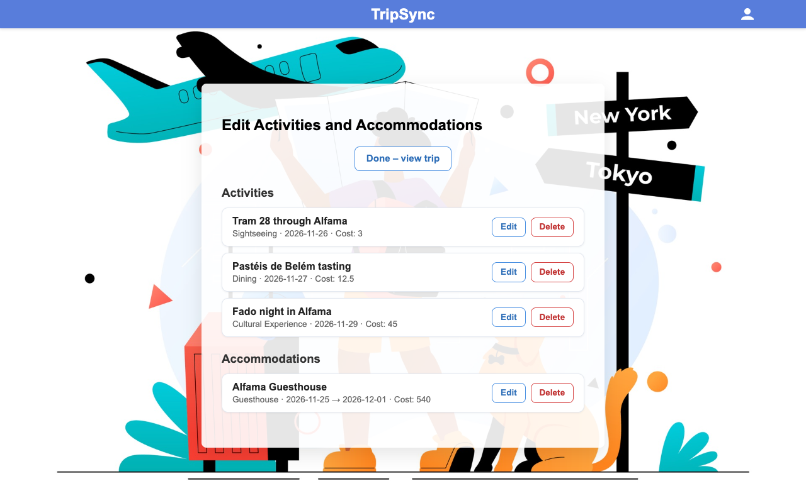
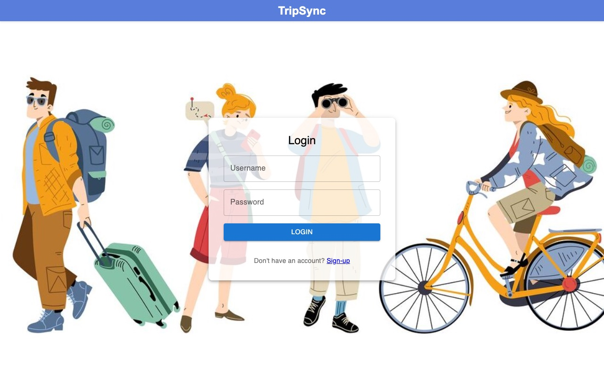
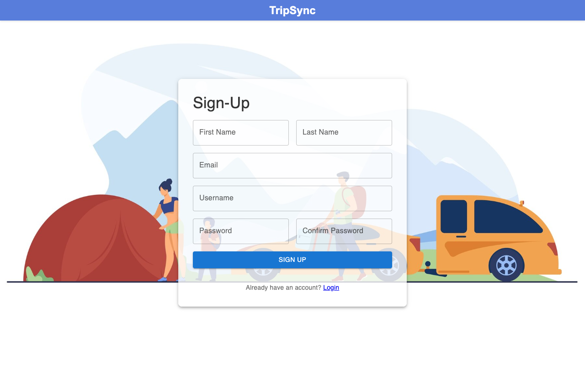

# TripSync

A full-stack travel itinerary manager: plan trips, then add and organize the activities and accommodations for each one.

[](https://github.com/saniyajadhav12/TripSync/actions/workflows/ci.yml)



<table>
  <tr>
    <td width="40%"></td>
    <td width="40%"></td>
    <td width="20%" rowspan="3"></td>
  </tr>
  <tr>
    <td align="center">Trip detail</td>
    <td align="center">Edit activities &amp; accommodations</td>
  </tr>
  <tr>
    <td></td>
    <td></td>
  </tr>
  <tr>
    <td align="center">Login</td>
    <td align="center">Sign up</td>
    <td align="center">Mobile</td>
  </tr>
</table>

## About this project

TripSync was built by a team of five for **CSYE 6200 Concepts of Object-Oriented Design** at Northeastern University in Fall 2024 (Prof. Daniel Peters).
This repository was uploaded as a single snapshot of the finished course project, so the team's original commit history is not included here.
The [post-course improvements](#post-course-improvements-2026-saniya-jadhav) listed below were made by Saniya Jadhav in 2026.

## Team and contributions

Original contributions during the course project:

| Member | GitHub | Original contributions |
| --- | --- | --- |
| Aditi Bailur | [@aditibailur2024](https://github.com/aditibailur2024) | Website navigation bar design, database connection configuration, Trip model, UI and backend integration for the Activities and Accommodations page |
| Atharva Hankare | [@atharvah009](https://github.com/atharvah009) | Class diagram, wireframes for the Profile and Home pages, User model, Home page UI, user registration and authentication, backend integration for the Home page |
| Pratham Rathod | [@rathodpratham15](https://github.com/rathodpratham15) | Trip creation and Login page wireframes, Spring Boot project configuration, UI and backend integration for the Trips page |
| **Saniya Jadhav** | [**@saniyajadhav12**](https://github.com/saniyajadhav12) | **Wireframes for the Trip Details and Activity Management pages, Accommodation model, Login and Sign Up UI and backend integration; all [post-course improvements](#post-course-improvements-2026-saniya-jadhav)** |
| Tejas Tawde | [@tejastawde28](https://github.com/tejastawde28) | Sequence diagram, Accommodation Management page wireframe, Activity model, UI and backend integration for the Profile page |

## Post-course improvements (2026, Saniya Jadhav)

### Security

- Spring Security with stateless JWT authentication; only sign-up and login are public.
- Password hashes are never returned: user endpoints return a dedicated response DTO instead of the entity.
- Per-user ownership: the current user always comes from the token, and another user's trip, activity or accommodation returns `404`. The endpoint that listed all users was removed.
- Login sends credentials in the JSON body only (the password used to be sent in the URL query string too).
- Database credentials and the JWT secret come from environment variables instead of the config file, and the app refuses to start without a JWT secret of at least 32 bytes.

### Reliability

- Request validation (required fields, `yyyy-MM-dd` dates, end date not before start date, non-negative costs) with readable messages.
- Consistent JSON error responses (`400`, `404`, `409`, `500`) that never include stack traces.
- Database-level unique constraints on username and email, mapped to `409 Conflict`.
- Fixed broken flows: the activity/accommodation edit page was unreachable and hard-coded to one trip, accommodation names could not be edited, the production build failed on TypeScript errors, a file-name case mismatch broke builds on Linux, and the login and sign-up backgrounds were missing from production builds.

### Quality

- Backend integration tests (Spring Boot, MockMvc, in-memory H2) covering authentication, ownership, validation and error handling, plus unit tests.
- Frontend tests with Vitest and Testing Library.
- GitHub Actions CI that builds and tests the backend and lints, tests and builds the frontend.
- Fixed all `npm audit` findings with non-breaking upgrades.

### UX

- Responsive layout for phones, tablets and laptops.
- Empty and loading states, a 404 page, and the backend's error messages shown on forms.
- Editing and deleting activities and accommodations (with confirmation), and navigation between trip details and item pages.
- Logged-out users are sent to the login page; logged-in users skip it.

### Developer experience

- Restructured the repository so the backend and `frontend/` live at the root, restored the Maven wrapper and added a single `.gitignore`.
- Environment-based configuration for the database, JWT, CORS and the frontend API URL.
- A `demo` Spring profile that seeds a demo account with sample trips ([docs/DEMO.md](docs/DEMO.md)).
- Compressed the bundled images and removed dead code and hotlinked images.

## Features

- Sign up and log in; the session lasts for the browser tab and the token expires after 60 minutes by default.
- Create, edit and delete trips with a destination, description and dates.
- Add activities to a trip (title, category, description, dates, cost).
- Add accommodations to a trip (name, type, address, check-in and check-out dates, cost, optional review).
- View a trip in tabs: overview, description, activities and accommodations.
- Edit and delete a trip's activities and accommodations.
- See your trips as a grid on the home page, and your account details and trip list on the profile page.
- Only your own trips are visible to you.

## Tech stack

| Area | Technologies |
| --- | --- |
| Backend | Java 21, Spring Boot 3.4 (Web, Data JPA, Validation, Security), JJWT 0.12, Lombok, MySQL, Maven (wrapper included) |
| Frontend | React 18, TypeScript 5, Vite 6, React Router 7, Material UI 6, Axios 1, Lucide icons |
| Testing | JUnit 5, Spring Boot Test, MockMvc, Spring Security Test, H2; Vitest 5, Testing Library, jsdom |
| CI | GitHub Actions (Temurin JDK 21, Node.js 22), ESLint 9 |

## Architecture

```text
React SPA (Vite)
   │  JSON over HTTP, Authorization: Bearer <JWT>
   ▼
Spring Boot REST API (/api)
   JWT filter → controllers → services → Spring Data JPA repositories
   ▼
MySQL
```

- **Controllers** map HTTP requests to DTOs and validate them.
- **Services** hold the business logic and the ownership checks.
- **Repositories** are Spring Data JPA interfaces over the `users`, `trip`, `activity` and `accommodation` tables.

The class and sequence diagrams in [diagrams/](diagrams/) are from the original course design and do not reflect the post-course changes.

### Security model

- Passwords are stored as BCrypt hashes. Login returns an HMAC-signed JWT (secret from `JWT_SECRET`, 60-minute expiry by default) that the frontend sends as a Bearer token.
- The API is stateless: no server-side sessions and no cookies, so CSRF protection is disabled.
- Every query is scoped to the user in the token. Resources owned by someone else return `404`, which does not reveal that they exist.
- CORS only allows the configured frontend origins. Missing or invalid tokens get a JSON `401`.

## API overview

All endpoints are under `/api` and exchange JSON. Errors have the shape `{ "message": "..." }`, and validation errors also include an `errors` map of field to message.

| Method | Path | Auth | Purpose |
| --- | --- | --- | --- |
| `POST` | `/api/users/signup` | No | Create an account (`201`, `409` if the username or email is taken) |
| `POST` | `/api/users/login` | No | Log in; returns `{ token, user }` |
| `GET` | `/api/users/me` | Yes | Current user's profile |
| `PUT` | `/api/users/me` | Yes | Update the profile (password changes only if a new one is sent) |
| `DELETE` | `/api/users/me` | Yes | Delete the account and its trips |
| `GET` | `/api/trips` | Yes | List your trips |
| `POST` | `/api/trips` | Yes | Create a trip (owner is taken from the token) |
| `GET` `PUT` `DELETE` | `/api/trips/{id}` | Yes | Read, update or delete one of your trips |
| `GET` | `/api/trips/user/{userId}` | Yes | List trips by user ID; only works for your own ID |
| `POST` | `/api/activities` | Yes | Add an activity to one of your trips (`tripId` in the body) |
| `GET` | `/api/activities/trip/{tripId}` | Yes | List a trip's activities |
| `GET` `PUT` `DELETE` | `/api/activities/{id}` | Yes | Read, update or delete an activity |
| `POST` | `/api/accommodations` | Yes | Add an accommodation to one of your trips (`tripId` in the body) |
| `GET` | `/api/accommodations/trip/{tripId}` | Yes | List a trip's accommodations |
| `GET` `PUT` `DELETE` | `/api/accommodations/{id}` | Yes | Read, update or delete an accommodation |

## Getting started

### Prerequisites

- JDK 21
- Node.js 22 (22.22 or newer, required by the frontend test tools)
- MySQL 8 or newer
- Maven is not needed separately: use the included `./mvnw` wrapper.

### 1. Create the database

```sh
mysql -u root -e "CREATE DATABASE tripsync"
```

The tables are created automatically when the backend starts.

### 2. Configure environment variables

| Variable | Default | Description |
| --- | --- | --- |
| `DB_URL` | `jdbc:mysql://localhost:3306/tripsync` | JDBC URL of the database |
| `DB_USERNAME` | `root` | Database user |
| `DB_PASSWORD` | empty | Database password |
| `JWT_SECRET` | none (required) | Secret for signing tokens, at least 32 bytes. Generate one with `openssl rand -base64 48` |
| `VITE_API_URL` | `http://localhost:8080` | Optional, frontend only: backend URL. See [frontend/.env.example](frontend/.env.example) |

Optional backend settings: `APP_CORS_ALLOWED_ORIGINS` (comma-separated, default `http://localhost:5173`) and `SHOW_SQL=true` to log SQL.

### 3. Run the backend

```sh
export JWT_SECRET="$(openssl rand -base64 48)"
./mvnw spring-boot:run
```

The API runs on <http://localhost:8080>.

### 4. Run the frontend

```sh
cd frontend
npm ci
npm run dev
```

Open <http://localhost:5173> and sign up.

### Demo account

To start with sample data, run the backend with the `demo` profile and log in as `demo` / `tripsync-demo`. These credentials are for local use only; see [docs/DEMO.md](docs/DEMO.md).

## Running tests

```sh
# Backend: unit and integration tests on in-memory H2 (no MySQL or JWT_SECRET needed)
./mvnw verify

# Frontend: lint, tests and production build
cd frontend
npm run lint
npm test
npm run build
```

[CI](.github/workflows/ci.yml) runs both on every pull request and on every push to `main`.

## Project structure

```text
TripSync/
├── src/main/java/edu/neu/csye6200/tripsync/
│   ├── config/         Security, CORS and the demo data seeder
│   ├── controller/     REST controllers
│   ├── dto/            Request and response objects
│   ├── exception/      JSON error handling
│   ├── model/          JPA entities
│   ├── repository/     Spring Data repositories
│   ├── security/       JWT service and filter
│   ├── service/        Business logic and ownership checks
│   └── validation/     Custom date constraints
├── src/main/resources/ application.properties
├── src/test/           Backend tests
├── frontend/           React + TypeScript app (Vite)
│   └── src/
│       ├── api/        API client and error helper
│       ├── components/ Header and route guards
│       ├── data/       TypeScript types for the API
│       ├── pages/      Pages
│       └── styles/     CSS
├── diagrams/           Original UML class and sequence diagrams
├── docs/               Demo guide and screenshots
└── .github/workflows/  CI
```

## License

Licensed under the [GNU General Public License v3.0](LICENSE).
